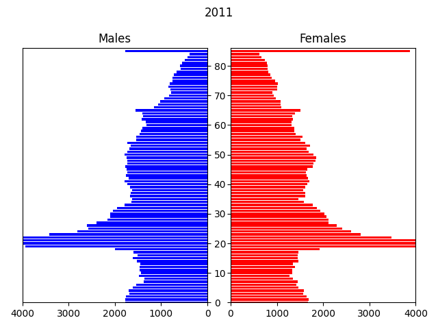

# Population Microsimulation



## Overview

In this example, the input data is a csv file containing a microsynthesised 2011 population of Newcastle generated from UK census data, by area (MSOA), age, gender and ethnicity. The transitions modelled are: ageing, births, deaths and migrations, over a period of 40 years to 2051.

Births, deaths and migrations (applied in that order) are modelled using Monte-Carlo simulation (sampling Poisson processes in various ways) using distributions parameterised by age, sex and ethnicity-specific fertility, mortality and migration rates respectively, which are largely fictitious (but inspired by data from the NewETHPOP[[1]](../references.md) project).

For the fertility model newborns simply inherit their mother's location and ethnicity, are born aged zero, and have a randomly selected gender (with even probability). The migration model is an 'in-out' model, i.e. it is not a full origin-destination model. Flows are either inward from 'elsewhere' or outward to 'elsewhere'.

People who have died, and outward migrations are simply removed from the population. (In a larger-scale model migrations could be redistributed).

At each timestep the check method computes and displays some summary data:

- the time
- the size of the population
- the mean age of the population
- the percentage of the population that are female
- the in and out migration numbers

{{ include_snippet("./docs/examples/src.md", show_filename=False) }}

## Setup

{{ include_snippet("examples/people/model.py") }}

## Model Implementation

Births, deaths and outward migrations are modelled with Bernoulli trials with hazard rates parameterised by age, sex and ethnicity. Inward migrations are modelled by sampling counts from a Poisson process with the intensity parameterised by age, sex and ethnicity.

population.py:

{{ include_snippet("examples/people/population.py") }}

## Execution

To run the model:

```bash
python examples/people/model.py
```

## Output

The model displays an animated population pyramid for the entire region being modelled (see above), plus some logging output with various statistics:

```text
...
[py 0/1(600608)] check OK: time=2045-01-01 size=325312 mean_age=41.98, pct_female=49.38 net_migration=1259.0 (20180-18921.0)
[py 0/1(600608)] check OK: time=2046-01-01 size=325666 mean_age=41.97, pct_female=49.36 net_migration=544.0 (19983-19439.0)
[py 0/1(600608)] check OK: time=2047-01-01 size=325847 mean_age=41.97, pct_female=49.36 net_migration=535.0 (19856-19321.0)
[py 0/1(600608)] check OK: time=2048-01-01 size=326556 mean_age=41.93, pct_female=49.38 net_migration=928.0 (20127-19199.0)
[py 0/1(600608)] check OK: time=2049-01-01 size=326982 mean_age=41.85, pct_female=49.35 net_migration=739.0 (19883-19144.0)
[py 0/1(600608)] check OK: time=2050-01-01 size=327113 mean_age=41.83, pct_female=49.31 net_migration=411.0 (19887-19476.0)
[py 0/1(600608)] check OK: time=2051-01-01 size=327961 mean_age=41.77, pct_female=49.26 net_migration=989.0 (20128-19139.0)
[py 0/1(600608)] run time = 8.93s
```

This 40 year simulation of an initial population of about 280,000 runs in under 10s on a single core of a medium-spec machine.
