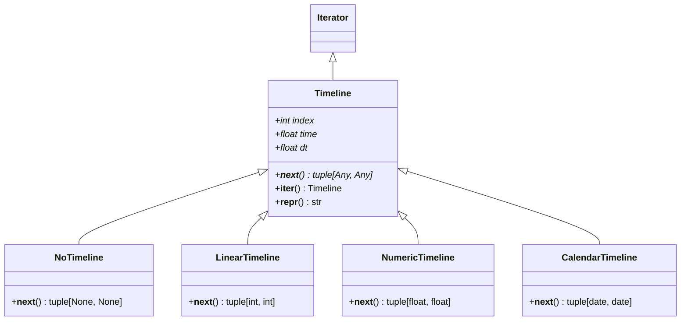

#  Overview

## The Framework

The aim of the framework is to be as unrestrictive and flexible as possible, whilst still providing a skeleton on which to implement a model, and a suite of useful tools. Being data agnostic means that this framework can be run standalone or easily integrated with other models and/or into workflows with specific demands on input and output data formats.

It is designed to support both serial and parallel execution modes, with the latter being used to tackle large populations or to perform sensitivity or convergence analysis. *neworder* runs as happily on a desktop PC as it does on a HPC cluster.

To help users familiarise themselves with the framework, a number of detailed examples covering a variety of use cases are provided. What follows here is a detailed overview of the package functionality.

## Provision

At at it heart, *neworder* simply provides a mechanism to iterate over a timeline and perform user-specified operations at each point on the timeline, with the help of a library of statistical and data manipulation functions.

This is provided by:

- a **Model** base class: providing the skeleton on which users implement their models
- a **Timeline**: the time horizon over which to run the model
- an optional spatial domain, which can be continuous (`Space`), discrete (`StateGrid`), or a graph (`GeospatialGraph`).
- a **MonteCarlo** engine: a dedicated random number stream for each model instance, with specific configurations for parallel streams
- a library of Monte-Carlo methods and statistical functions, plus compatibility with `numpy`'s statistical functionality through an adapter
- data manipulation functions optimised for *pandas* DataFrames
- support for parallel execution using MPI (via the `mpi4py` package), or alternatively using multithreading.

*neworder* explicitly does not provide any tools for things like visualisation, and users can thus use whatever packages they are most comfortable with. The examples, however, do provide various visualisations using `matplotlib`.

## Model Requirements

### Timeline

*neworder*'s timeline is an iterator over a sequence of steps, each of which is an interval with a start and an end. The model iterates over it, calling the Model's `step` and (optionally) `check` methods after each step is taken, plus the `finalise` method after the last step, which is commonly used to post-process the raw model data at the end of the model run. Timelines should not be advanced in client code, this happens automatically within the model.

A timeline behaves like a clock. Before the model runs it is at its start, with `index` 0, and the model's `modify` method sees this state. Each step advances the clock, so during the first call to `step` the index is 1 and the time is the end of the first step. Each timeline has a *native* type for its time points (e.g. `int` or `date`), and iterating over it yields each step as a `(start, end)` tuple of native values. Inside the model, though, time is always a `float`, so that it can be used directly in computations (e.g. with the Monte-Carlo functions) and compared with the `neworder.time` constants:

- `timeline.index` is the number of steps taken
- `timeline.time` is the current time: the start before any steps, and the end of the most recent step thereafter
- `timeline.dt` is the length of the most recent step, so the step started at `timeline.time - timeline.dt`. Before the first step it's the step size for timelines with fixed steps, and `NEVER` otherwise

The framework is extensible but provides four types of timeline (all implemented in python):

Timeline | native type | float time | use for
---------|-------------|------------|---
`NoTimeline()` | `None` | `NEVER`, with `dt` zero | continuous-time models in which the model evolution is computed in a single step
`LinearTimeline(start=0, end=None)` | `int` | the native value | integer time with unit steps, either fixed or open-ended (if `end` is omitted)
`NumericTimeline(start=..., step=..., end=None)` | `float` | the native value | non-integer time with equal steps, either fixed (`end - start` must be a whole number of steps) or open-ended
`NumericTimeline(times)` | `float` | the native value | non-integer time from a list or array of (strictly increasing) time points, allowing for unequally-spaced steps
`CalendarTimeline(start=..., step=..., end=None)` | `date` | days since `start` | calendar dates with steps defined daily, monthly or annually (as a `relativedelta`), either fixed or open-ended. Monthly steps preserve the day of the month where possible

As timelines are ordinary python iterators they can be inspected outside a model, e.g. `list(neworder.LinearTimeline(0, 3))` returns `[(0, 1), (1, 2), (2, 3)]`.

#### Custom timelines

If none of the supplied timelines are suitable, users can implement their own, deriving from the abstract `neworder.Timeline` base class (which is implemented in C++). The supplied timelines, in `neworder/timeline.py`, can be used as examples.

The following properties and methods must be overridden in the subclass:

symbol     | type              | description
-----------|-------------------|---
`index`    | `int` property    | the number of steps taken
`time`     | `float` property  | the current time: the start, then the end of the most recent step
`dt`       | `float` property  | the length of the most recent step
`__next__` | method            | take the next step and return it as a `(start, end)` tuple of native values, or raise `StopIteration` if there are no more steps
`__repr__` | `str` method      | (optional) a string representation of the object, defaults to the name of the class and the index

A subclass that doesn't implement one of the abstract members raises a `TypeError` when it is accessed, which happens at the latest when the timeline is passed to a model.

!!! note "Halting and resuming"
    If a model calls `halt()`, the timeline is not advanced, so a subsequent call to `neworder.run` resumes at the next step. Running a model whose timeline is exhausted raises `StopIteration`.

### Spatial Domain

*neworder* models do not require a spatial domain, but the following functionality is provided for cases where there is a spatial element to the problem being modelled.

#### Continuous

The `Space` class to encapsulate a continuous space with arbirtrary dimensionality. The edges of the space can be unbounded, wrap-around, contrained, or "bounce". The `move` method will ensure that entities in the space are assigned the appropriate position and velocity to conform with the edge behaviour. Additionally the methods `dist2` and `dist` and compute distances in the space taking into account the edge behaviour (i.e. wrap-around). `dist2` returns the squared distance and, if appropriate, is a more efficient alternative.

See the [boids](examples/boids.md) examples for implementations.

#### Discrete

The `StateGrid` class provides a discrete grid of arbitrary states. Wrapped and contrained edges (only) are supported.

See the [Conway](examples/conway.md) example for implementations.

#### Graph

The `GeospatialGraph` class provides a wrapper around the `networkx` and `osmnx` packages, and provides methods for computing shortest paths, isochrones, and subgraphs as well as identifying edges connected to nodes and vice versa. Due to its heavy dependencies, it an extra - installed using `pip install neworder[geospatial]`.

### Model

In order to construct a functioning model, the minimal requirements of the model developer are to:

- create a subclass of `neworder.Model`
- implement the following class methods:
    - a constructor
    - the `step` method (which is run at every timestep)
- define a timeline (see above) over which the model runs
- set a seeding policy for the random stream (3 are provided, but you can create your own)
- instantiate an instance of the subclass with the timeline and seeding policy
- then, simply pass your model to the `neworder.run` function.

the following can also be optionally implemented in the model:

- a `modify` method, which is called at the start of the model run and can be used for instance to modify the input data for different processes in a parallel run, for batch processing or sensitivity analysis.
- a `check` method, which is run at every timestep, to e.g. perform checks simulation remains plausible.

!!! note "Additional class methods"
    There are no restrictions on implementing additional methods in the model class, although bear in mind they won't be available to the *neworder* runtime (unless called by one of the functions listed above).

Pretty much everything else is entirely up to the model developer. While the module is completely agnostic about the format of data, the library functions accept and return *numpy* arrays, and it is recommended to use *pandas* dataframes where appropriate in order to be able to use the fast data manipulation functionality provided.

Like MODGEN, both time-based and case-based models are supported. In the latter, the timeline refers not to absolute time but the age of the cohort. Additionally continuous-time models can be implemented, using a `NoTimeline` (see above) with only a single transition, and the Monte-Carlo library specifically provides functions for continuous sampling, e.g. from non-homogeneous Poisson processes.

New users should take a look at the examples, which cover a range of applications including implementations of some MODGEN teaching models.

## Data and Performance

*neworder* is written in python and C++ with the python bindings provided by the *pybind11* package. As python and C++ have very different memory models, it's generally not advisable to directly share data, i.e. to safely have a python object and a C++ object both referencing (and potentially modifying) the same memory location. Thus *neworder* class member variables are accessible only via member functions and results are returned by value (i.e. copied). However, there is a crucial exception to this: the *numpy* `ndarray` type. This is fundamental to the operation of the framework, as it enables the C++ module to directly access (and modify) both *numpy* arrays and *pandas* data frames, facilitiating very fast implementation of algorithms operating directly on *pandas* DataFrames.[^1]

!!! note "Explicit Loops"
    To get the best performance, avoid using explicit loops in python code where "vectorised" *neworder* (or e.g. numpy) functions can be used instead.

You should also bear in mind that while python is a *dynamically typed* language, C++ is *statically typed*. If an argument to a *neworder* method is not the correct type, it will fail immediately (as opposed to python, which will fail only if an invalid operation for the given type is attempted). Note also that `neworder`'s python code has type annotations.

[^1]: the `neworder.df.transition` function is *over 2 or 3 orders of magnitude faster* than a (naive) equivalent python implementation depending on the length of the dataset, and still an order of magnitude faster than an optimised python implementation.
